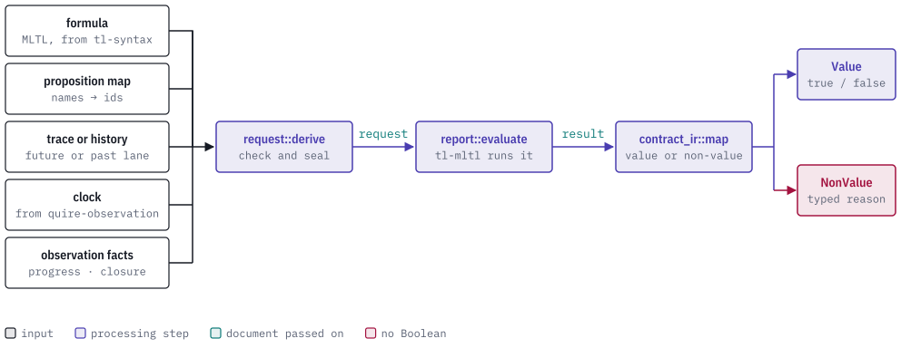
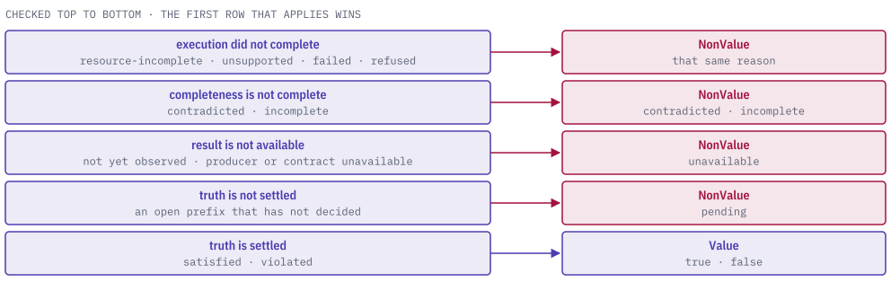
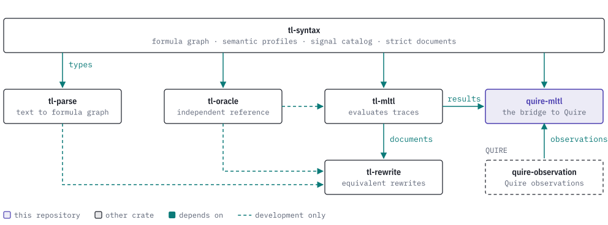

# quire-mltl

[](https://discord.gg/k8DVhuYBR2)
[](#license)
[](Cargo.toml)

quire-mltl is a Rust crate that evaluates a Mission-time Linear Temporal Logic
(MLTL) formula against a recorded trace or history and reports the result as a
Boolean value or a typed reason why there is no value. It is the one crate in the
TL family that depends on Quire: [tl-syntax](https://github.com/agent-ix/tl-syntax)
defines the formula types, [tl-parse](https://github.com/agent-ix/tl-parse) reads
text, [tl-rewrite](https://github.com/agent-ix/tl-rewrite) rewrites formulas,
[tl-mltl](https://github.com/agent-ix/tl-mltl) evaluates them and
[tl-oracle](https://github.com/agent-ix/tl-oracle) cross-checks the evaluator in tests.

The crate admits a formula, a proposition map, a trace or history, a clock and
the progress, closure, completeness and availability facts that
[quire-observation](https://github.com/agent-ix/quire-observation) reports, and
writes them as one canonical request. It evaluates the request with tl-mltl and maps
the result to a value or a named non-value. It does not parse formulas, rewrite
them or implement temporal semantics, and it does not produce the observation facts.

<picture>
  <source media="(prefers-color-scheme: dark)" srcset="docs/images/hero-dark.svg">
  
</picture>

> **Status: prerelease.** The crate is at version 0.1.0 and has `publish = false`.
> It depends on tl-mltl, tl-syntax and quire-observation through git, and its wire
> formats may change.

## Usage

One request gives one result at one evaluation point, the `anchor`. The excerpt
below is from the first test in
[`tests/tc_084_temporal_owner_wire.rs`](tests/tc_084_temporal_owner_wire.rs),
`tc_084_future_and_past_requests_evaluate_and_strict_read`. It starts from
`future_request`, a request that `request::derive` wrote and `request::read`
checked. It evaluates the request, reads the result back and maps it.

```rust
let result_document = report::evaluate(
    &future_request,
    report::ResultRelationInput::Original,
    OwnerLimits::default(),
)
.unwrap();
let result = report::read(
    result_document.bytes(),
    &future_request,
    report::ResultRelationInput::Original,
    OwnerLimits::default(),
)
.unwrap();
assert_eq!(result.truth(), report::TemporalTruth::Satisfied);

let selection = MappingSelection::for_result(&result);
let mapped_document = contract_ir::map(&result, &selection, OwnerLimits::default()).unwrap();
let mapped = contract_ir::read(
    mapped_document.bytes(),
    &result,
    &selection,
    OwnerLimits::default(),
)
.unwrap();
assert_eq!(mapped.outcome(), MappedOutcome::Value { value: true });
```

Every document carries an identity computed from its own canonical bytes. Every
`read` re-derives the document from its inputs and refuses on any mismatch, so a
result cannot be read against a different request and a mapping cannot be read
against a result it was not selected for. More examples are in
[docs/examples.md](docs/examples.md).

## Reference

| Module | Contract label | What it does |
| --- | --- | --- |
| `request` | `quire-mltl.temporal-assessment-request/v1` | Admits the inputs and writes one canonical request. `derive` writes it and `read` checks bytes against independently supplied inputs. |
| `report` | `quire-mltl.temporal-assessment-result/v1` | Evaluates a request with the tl-mltl future or past evaluator and records execution, truth, settlement, decision support, resource usage and the relation to an earlier result. |
| `contract_ir` | `quire-mltl.contract-ir-result-map/v1` | Maps a result to `Value { value }` or `NonValue { reason }` and embeds the whole source result. |
| `dispatch` | the request label | Reports which Quire observation contracts the crate consumes. |
| `census` | none | A closed registry of the native/temporal correspondence classes, each applicable, excluded with a reason, or blocked on a named dependency. |

| Result field | Values |
| --- | --- |
| `execution` | `completed`, `resource-incomplete`, `unsupported`, `failed`, `refused` |
| `truth` | `satisfied`, `violated`, `pending`, `unavailable` |
| `settlement` | `closed-scope`, `decisive-witness`, `decisive-counterexample`, `unsettled`, `unavailable` |
| `relation` | `original`, `superseding`, `invalidating` |

The non-value reasons are `pending`, `unavailable`, `incomplete`, `unsupported`,
`failed`, `refused`, `contradicted` and `resource-incomplete`. `contract_ir::map`
checks the result in a fixed order and the first row that applies decides the
outcome. Only a completed, complete, available and settled result becomes a Boolean.

<picture>
  <source media="(prefers-color-scheme: dark)" srcset="docs/images/outcomes-dark.svg">
  
</picture>

The JSON Schemas for the three contracts are in [`schemas/`](schemas/). See
[docs/api-reference.md](docs/api-reference.md) for the public items.

## The TL stack

tl-syntax holds the types every TL crate shares. tl-parse reads text into formula
graphs, tl-rewrite and tl-mltl work on them, tl-oracle is a development-only
reference evaluator, and quire-mltl is the one crate that connects the family to Quire.

<picture>
  <source media="(prefers-color-scheme: dark)" srcset="docs/images/tl-stack-dark.svg">
  
</picture>

[docs/how-it-works.md](docs/how-it-works.md) shows where each crate sits in the
text-to-outcome pipeline.

## Quire ecosystem

quire-mltl depends on [tl-mltl](https://github.com/agent-ix/tl-mltl) and
[tl-syntax](https://github.com/agent-ix/tl-syntax) for the formula, trace and
evaluator, and on [quire-observation](https://github.com/agent-ix/quire-observation)
for the progress, closure, completeness, availability and clock assertions. Its
mapped outcomes are shaped to join the native/temporal correspondence contract in
[quire-contract-ir](https://github.com/agent-ix/quire-contract-ir), which the crate
names by label and does not depend on.

<picture>
  <source media="(prefers-color-scheme: dark)" srcset="docs/images/ecosystem-dark.svg">
  
</picture>

## Building and testing

```sh
make test   # cargo test
make ci     # format, clippy, tests, cargo deny, rustdoc
```

The Rust toolchain is pinned in [`rust-toolchain.toml`](rust-toolchain.toml).
Hosted CI runs only when dispatched by hand, so run `make ci` before opening a
pull request. The build fetches quire-observation, tl-mltl and tl-syntax from
GitHub, so it needs read access to those repositories. The requirements and
architecture decisions are in [`spec/`](spec/).

## Contributing

Read [CONTRIBUTING.md](CONTRIBUTING.md) and [CLA.md](CLA.md). See
[AGENTS.md](AGENTS.md) for the repository workflow.

## License

Licensed under [AGPL-3.0-or-later](LICENSE). quire-mltl incorporates
quire-observation, which is also AGPL-3.0-or-later.
