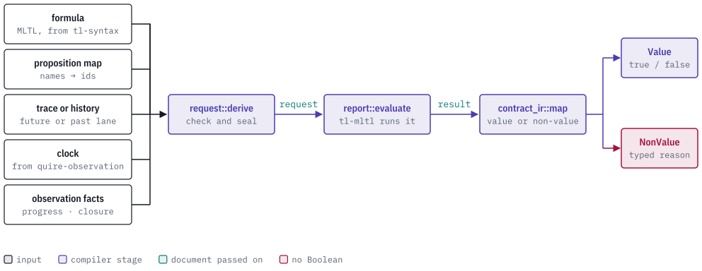
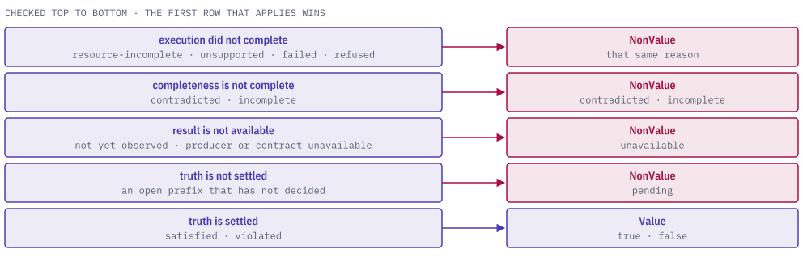

# quire-mltl

[](https://discord.gg/k8DVhuYBR2)

`quire-mltl` is a Rust crate that checks an MLTL (mission-time linear temporal
logic) formula against a recorded trace. It returns a Boolean, or a typed reason
why there is no value.

It admits the trace and the facts [quire-observation](https://github.com/agent-ix/quire-observation)
reports about it, evaluates the formula with
[tl-mltl](https://github.com/agent-ix/tl-mltl), and maps the result to a value
or a named reason such as pending or incomplete. It is the only crate that
depends on both the `tl-*` crates and the Quire layers.

<picture>
  <source media="(prefers-color-scheme: dark)" srcset="docs/images/hero-dark.svg">
  
</picture>

One request gives one result at one evaluation point (the `anchor`). The formula is judged from that position, over either a
finite future trace or an origin-complete history, and the result records the
truth, whether it is settled, and the exact inputs it was computed from.

> **Status: public prerelease.** The crate is at 0.1.0, is not published to any
> registry (`publish = false`), and its wire formats may still change.

## Usage

This is the core of the first test in
[`tests/tc_084_temporal_owner_wire.rs`](tests/tc_084_temporal_owner_wire.rs).
It takes an already admitted request (built from a formula, a trace and the
observation views by `request::derive` and `request::read`), evaluates it, reads
the result back, and maps it:

```rust
let result_document = report::evaluate(
    &future_request,
    report::ResultRelationInput::Original,
    OwnerLimits::default(),
)
.unwrap();
let result = report::read(
    result_document.bytes(),
    &future_request,
    report::ResultRelationInput::Original,
    OwnerLimits::default(),
)
.unwrap();
assert_eq!(result.truth(), report::TemporalTruth::Satisfied);

let selection = MappingSelection::for_result(&result);
let mapped_document = contract_ir::map(&result, &selection, OwnerLimits::default()).unwrap();
let mapped = contract_ir::read(
    mapped_document.bytes(),
    &result,
    &selection,
    OwnerLimits::default(),
)
.unwrap();
assert_eq!(mapped.outcome(), MappedOutcome::Value { value: true });
```

Every document carries an identity computed from its own canonical bytes, and
every `read` re-derives the document from its inputs and refuses on any
mismatch. A result cannot be read against a different request, and a mapping
cannot be made from a result it was not selected for.

## Outcomes

`contract_ir::map` checks the result in a fixed order, and the first row that
applies decides the outcome. Only a completed, complete, available and settled
result becomes a Boolean.

<picture>
  <source media="(prefers-color-scheme: dark)" srcset="docs/images/outcomes-dark.svg">
  
</picture>

## Modules

Each module owns one wire contract. The contract labels are constants in the
code, and the JSON Schemas are checked in under [`schemas/`](schemas/).

| Module | Contract label | What it does |
| --- | --- | --- |
| `request` | `quire-mltl.temporal-assessment-request/v1` | Admits the formula, proposition map, trace or history, clock and the four scope assertions (progress and closure, for the decision scope and the surrounding execution), plus completeness and availability, into one request. `derive` writes it; `read` checks bytes against independently supplied inputs. |
| `report` | `quire-mltl.temporal-assessment-result/v1` | Evaluates a request through tl-mltl's future or past evaluator. Records execution, truth, settlement basis, decision support, resource usage and the correction relation to an earlier result. |
| `contract_ir` | `quire-mltl.contract-ir-result-map/v1` | Maps a validated result to `Value { value }` or `NonValue { reason }`, embedding the whole source result so the two can be joined without loss. |
| `dispatch` | uses the request label | Reports which Quire observation contracts this crate consumes. Temporal assessments are supported; the repair-plan and closed-population-query contracts belong to quire-observation and are reported as unsupported. |
| `census` | none | A closed, reviewed registry of the classes of native/temporal correspondence, each marked applicable, excluded with a reason, or blocked on a named dependency. |

### Result fields

| Field | Values |
| --- | --- |
| `execution` | `completed`, `resource-incomplete`, `unsupported`, `failed`, `refused` |
| `truth` | `satisfied`, `violated`, `pending`, `unavailable` |
| `settlement` | `closed-scope`, `decisive-witness`, `decisive-counterexample`, `unsettled`, `unavailable` |
| `relation` | `original`, `superseding`, `invalidating` |

Truth, execution and the observation facts are recorded separately, so a
result can say "satisfied" while the completeness assertion still keeps it from
becoming a value.

### Non-value reasons

`pending`, `unavailable`, `incomplete`, `unsupported`, `failed`, `refused`,
`contradicted`, `resource-incomplete`.

## The Quire ecosystem

`quire-mltl` is a backend: it sits between the temporal-logic crates and the
observation layer. It depends on [tl-mltl](https://github.com/agent-ix/tl-mltl)
and [tl-syntax](https://github.com/agent-ix/tl-syntax) for the formula, trace and
evaluator, and on
[quire-observation](https://github.com/agent-ix/quire-observation) for the
progress, closure, completeness, availability and clock assertions. Its mapped
outcomes are shaped to join the native/temporal correspondence contract in
[quire-contract-ir](https://github.com/agent-ix/quire-contract-ir), which is
referenced by label only and is not a dependency.

<picture>
  <source media="(prefers-color-scheme: dark)" srcset="docs/images/ecosystem-dark.svg">
  
</picture>

## Building and testing

```bash
make ci
```

`make ci` runs formatting, clippy, the tests, `cargo deny`, the unsafe-comment
audit and the docs build. The Rust toolchain is pinned in
[`rust-toolchain.toml`](rust-toolchain.toml). Hosted CI runs only when
dispatched by hand, so run the gate locally before opening a pull request.

The requirements live in [`spec/`](spec/): [`spec/spec.md`](spec/spec.md) is the
master specification, with each requirement under
[`spec/requirements/`](spec/requirements/) and the architecture decisions under
[`spec/decisions/`](spec/decisions/). Tests carry `Trace:` tags naming the
criteria they check. The figures are regenerated with the dev-tools
`docs-figures` skill from [`docs/images/figures.py`](docs/images/figures.py).

## Contributing

Contributions need the [CLA](CLA.md). See [CONTRIBUTING.md](CONTRIBUTING.md) and
[AGENTS.md](AGENTS.md).

## License

Licensed under [AGPL-3.0-or-later](LICENSE), the default for `quire-*` program
repositories. `quire-mltl` directly incorporates `quire-observation`, which is
also `AGPL-3.0-or-later`, so nothing in the dependency graph requires a narrower
term. See [LICENSE-DECISION.md](LICENSE-DECISION.md).
