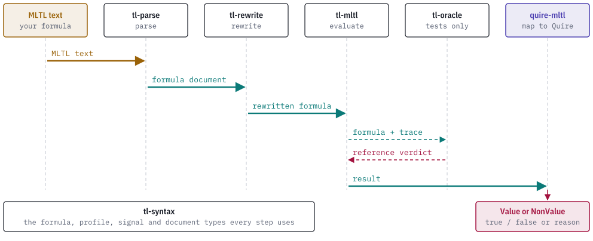

# How it works

## Three documents

The crate exchanges three canonical JSON documents. Each carries a `contractVersion` label and an `identity` computed from its own canonical bytes.

| Document | Module | Label |
| --- | --- | --- |
| Temporal assessment request | `request` | `quire-mltl.temporal-assessment-request/v1` |
| Temporal assessment result | `report` | `quire-mltl.temporal-assessment-result/v1` |
| Contract-IR result map | `contract_ir` | `quire-mltl.contract-ir-result-map/v1` |

`request::derive` writes a request from owner-read inputs. `report::evaluate` evaluates a validated request and writes a result. `contract_ir::map` maps a validated result to a value or a non-value. Each module also has a `read` function that takes bytes plus the exact inputs the document should have been derived from. `read` re-derives the document and refuses with an `OwnerReadError` on any difference, including a stale identity, a different contract label, a non-canonical encoding or a resource ceiling exceeded. The three schemas are checked in under [`schemas/`](../schemas/).

## Lanes

A request selects one of two evaluator lanes from its formula and input.

| Lane | Formula | Input | Evaluator |
| --- | --- | --- | --- |
| `future` | Formula document v1 with the `mltl.closed-trace/v1` or `mltl.online-prefix/v1` profile and no past operator | A validated trace | The tl-mltl future evaluator |
| `past` | Formula document v2 with the `mltl.origin-complete-history/v1` profile and no future operator | A validated origin-complete position history | The tl-mltl past evaluator |

A `closed-trace/v1` formula requires a closed trace. The past lane requires the anchor to be at or before the last history position. A formula with a mismatched profile, schema version or operator family is refused at admission.

## Checks in a result

A result keeps four independent facts: the execution disposition, the truth, the settlement basis and the observation assertions copied from the request. `execution` is `completed` when the tl-mltl evaluator returned a verdict. A closed trace settles as `closed-scope`. An open prefix that decides settles as `decisive-witness` or `decisive-counterexample`, and one that does not stays `pending` and `unsettled`. Decision support lists the observation identities of the available completeness facts, and only for a final result.

`contract_ir::map` reads those facts in a fixed order and the first row that applies decides the outcome:

1. An execution other than `completed` maps to the non-value with the same name.
2. Completeness `contradicted` or `incomplete` maps to the non-value of that name.
3. An availability state other than `available` maps to `unavailable`.
4. A result that is not final maps to `pending` when its truth is pending and to `unavailable` otherwise.
5. A final `satisfied` or `violated` result maps to `Value { value: true }` or `Value { value: false }`.

The mapping embeds the whole source result, so a consumer can join the two without loss.

## Where the crate sits

A formula passes through several crates on its way from text to a Quire outcome. quire-mltl is the last step.

<picture>
  <source media="(prefers-color-scheme: dark)" srcset="images/pipeline-dark.svg">
  
</picture>

The calling program moves documents from one stage to the next. The dependency structure between the crates is in the [README](../README.md#the-tl-stack).
